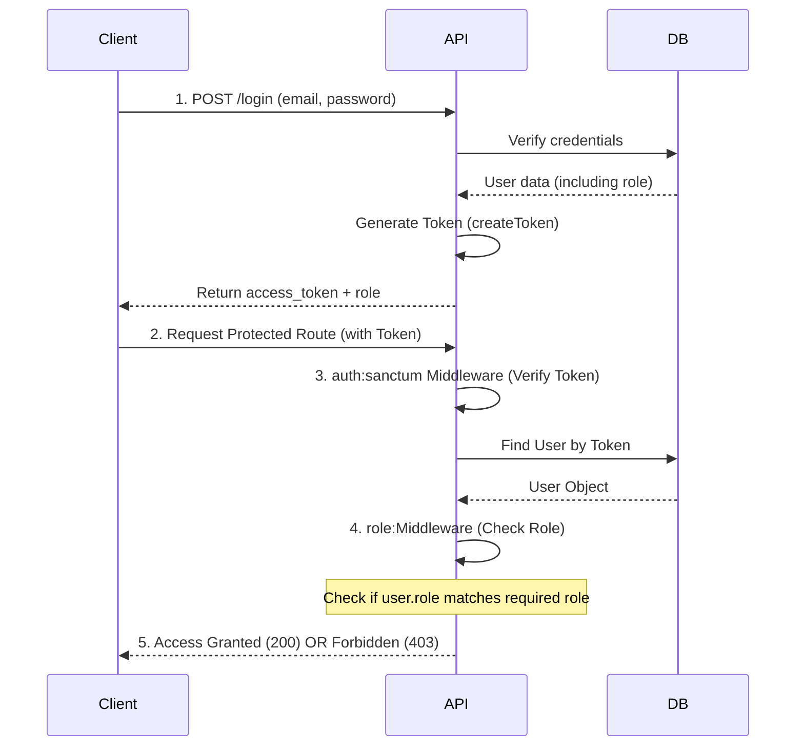

# Laravel Sanctum Role-Based Authentication Summary

## 📋 Overview
This guide implements a **Role-Based Access Control (RBAC)** system using **Laravel Sanctum** for API authentication. The system supports four roles: `administrator`, `mentor`, `teacher`, and `student`.

---

## 🔄 The Authentication & Authorization Flow



### Key Concepts
1.  **Authentication (`auth:sanctum`)**: Verifies **who** the user is (via token). Returns `401` if invalid.
2.  **Authorization (`role:middleware`)**: Verifies **what** the user can do (via role column). Returns `403` if insufficient permissions.
3.  **Token Simplicity**: The token is just a key. It does **not** contain role data. Roles are checked against the database on every request.

---

## 🛠️ Step-by-Step Implementation

### 1. Database Setup
Ensure your `users` table has a `role` column.
```php
// Migration example
$table->string('role')->default('student'); // Options: administrator, mentor, teacher, student
```

### 2. Create the Middleware
Generate the file:
```bash
php artisan make:middleware CheckRole
```

Edit `app/Http/Middleware/CheckRole.php`:
```php
public function handle(Request $request, Closure $next, ...$roles): Response
{
    $user = $request->user();

    // Check if user exists and has one of the required roles
    if (!$user || !in_array($user->role, $roles)) {
        return response()->json(['message' => 'Unauthorized. Insufficient role.'], 403);
    }

    return $next($request);
}
```

### 3. Register the Middleware (Laravel 11)
Edit `bootstrap/app.php`:
```php
use App\Http\Middleware\CheckRole;

return Application::configure(basePath: dirname(__DIR__))
    ->withMiddleware(function (Middleware $middleware) {
        $middleware->alias([
            'role' => CheckRole::class,
        ]);
    })
    ->create();
```

### 4. Add Helper Methods to User Model
Edit `app/Models/User.php` for cleaner code:
```php
public function isAdmin(): bool {
    return $this->role === 'administrator';
}

public function hasAnyRole(array $roles): bool {
    return in_array($this->role, $roles);
}
```

### 5. Protect Routes (`routes/api.php`)
Apply the middleware to your routes:
```php
// Any logged-in user
Route::middleware(['auth:sanctum'])->group(function () {
    Route::get('/profile', [ProfileController::class, 'show']);
});

// Specific Roles
Route::middleware(['auth:sanctum', 'role:administrator'])->group(function () {
    Route::get('/admin/stats', [AdminController::class, 'stats']);
});

Route::middleware(['auth:sanctum', 'role:teacher,mentor'])->group(function () {
    Route::post('/lessons', [LessonController::class, 'store']);
});
```

### 6. Alternative: Check Roles in Form Requests
If using Form Requests (`php artisan make:request StoreLessonRequest`):
```php
public function authorize(): bool
{
    $user = $this->user();
    // Allow if Administrator OR Mentor
    return $user->hasAnyRole(['administrator', 'mentor']);
}
```

---

## 📊 Comparison: Where to Check Roles?

| Method | Location | Best Use Case | Pros | Cons |
| :--- | :--- | :--- | :--- | :--- |
| **Middleware** | `api.php` | Protecting entire routes/endpoints | Clean, declarative, stops request early | Less flexible for complex logic |
| **Form Request** | `authorize()` | Validation-specific logic | Keeps logic close to validation, readable | Request must reach this stage first |
| **Controller** | Inside method | Fine-grained, dynamic checks | Maximum flexibility | Clutters controller logic |

**Recommendation:** Use **Middleware** for general route protection and **Form Requests** for specific action validation.

---

## 🔑 Login Controller Example
No changes needed to token generation. Return the role in the response body for the frontend to use.
```php
public function login(Request $request)
{
    $user = User::where('email', $request->email)->first();

    if (!$user || !Hash::check($request->password, $user->password)) {
        return response()->json(['message' => 'Invalid credentials'], 401);
    }

    $token = $user->createToken('auth_token')->plainTextToken;

    return response()->json([
        'access_token' => $token,
        'token_type' => 'Bearer',
        'role' => $user->role, // Send role to frontend
        'user' => $user
    ]);
}
```

